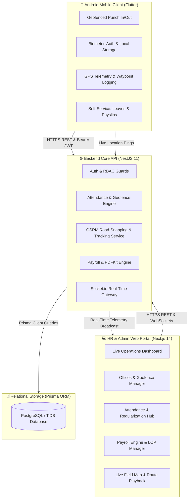
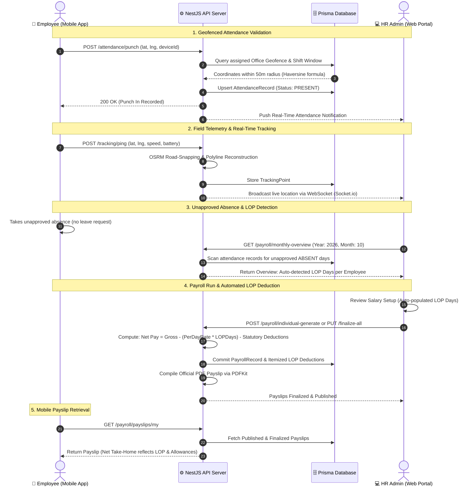

# HRMS & Field Workforce Management System

[](https://nextjs.org/)
[](https://nestjs.com/)
[](https://flutter.dev/)
[](https://www.prisma.io/)
[](https://socket.io/)
[](https://www.typescriptlang.org/)
[](https://tailwindcss.com/)

A cloud-native, full-stack **Human Resource Management System (HRMS) & Real-Time Field Operations Platform** engineered for modern enterprises managing both stationary office personnel and mobile field operational teams (e.g., aeronautical engineers, drone pilots, and field technicians).

The platform bridges real-time mobile telemetry with core HR administration:
- **Mobile First**: Geofenced punch in/out with Haversine distance validation, biometric authentication (fingerprint/face unlock), field route GPS telemetry, and instant employee self-service (leaves, regularizations, and payslips).
- **Administrative Precision**: Multi-tenant enterprise hierarchy, automated attendance derivation, unapproved absence / Loss of Pay (LOP) salary deductions, automated payroll calculation, PDF generation, and real-time live map tracking with OSRM road-snapping.

---

## System Architecture



---

## End-to-End Operational Flow



---

## Key Modules & Core Capabilities

### 1. 📱 Android Mobile Application (`Android_App/`)
- **Biometric Security**: Hardware fingerprint and facial recognition login using `local_auth` and encrypted JWT key storage (`flutter_secure_storage`).
- **Geofenced Punch In/Out**: Real-time GPS verification against corporate office geofences using the Haversine spherical distance formula.
- **Field Telemetry & Route Logging**: Background GPS waypoint recording with battery monitoring and automatic retry mechanisms.
- **Employee Self-Service**:
  - Apply for Casual, Sick, or Earned leaves with real-time balance tracking.
  - Submit attendance regularizations with custom justifications.
  - View published monthly payslips with a single-year calendar filter (e.g., `2026`) and itemized earnings/deductions breakdown.
- **Multi-Environment Switcher**: One-tap server switching between Live Cloud (Render), Localhost (USB Port Forwarding), and Local Wi-Fi.

### 2. 💻 Web Administration Portal (`Web_App/apps/web/`)
- **Executive Operations Dashboard**: Live workforce metrics, today's presence percentage, late arrivals, on-leave employees, and pending approvals.
- **Offices & Geofence Manager**: Visual map interface to configure office locations, coordinates (Latitude/Longitude), and custom boundary radii (default 50m).
- **Attendance & Regularization Hub**: Daily, monthly, and in/out attendance audits with 1-click approvals/rejections for regularization requests.
- **Enterprise Payroll Engine**:
  - Salary structure configuration (Basic, HRA, DA, Conveyance, Special Allowances).
  - Statutory deduction automation: EPF (12%), ESI (0.75%), Professional Tax (PT), and TDS withholding.
  - **Automated Loss of Pay (LOP)**: Auto-derives unapproved absences from daily attendance, calculates per-day salary rate, and applies strict per-employee isolated deductions.
  - Bulk Excel/CSV upload, batch payroll runs, and instant mobile publishing.
- **Live Field Tracking & Route Playback**:
  - OpenStreetMap & Leaflet integration with **OSRM road-snapped polyline reconstruction**.
  - Distinct visual markers for field personnel vs. office employees.
  - Variable speed route replay (`1x`, `2x`, `5x`) with timeline pins, speed telemetry, and IST-formatted timestamps.

### 3. ⚙️ High-Performance Backend API (`Web_App/apps/api/`)
- **Architecture**: Modular NestJS 11 with strict dependency injection, DTO validation (`class-validator`), and JWT role-based access guards (`SUPER_ADMIN`, `HR_ADMIN`, `HR_MANAGER`, `EMPLOYEE`).
- **Real-Time Gateway**: Low-latency WebSocket gateway (`socket.io`) for live telemetry streaming to admin consoles.
- **PDF Generation Engine**: Programmatic server-side payslip generation via `pdfkit` complete with company branding and itemized tax breakdowns.
- **Automated Schedulers**: Background cron jobs (`@nestjs/schedule`) for midnight attendance roll-ups and shift closures.

---

## Complete Technology Stack

| Domain | Technology / Library | Description |
| :--- | :--- | :--- |
| **Mobile Frontend** | Flutter 3.x / Dart | Cross-platform native mobile application |
| **Mobile Networking** | `dio: ^5.7.0` | HTTP client with JWT interceptors & error handlers |
| **Mobile Security** | `flutter_secure_storage: ^9.2.2` | Encrypted device keystore token persistence |
| **Mobile Biometrics** | `local_auth: ^2.3.0` | Fingerprint & facial recognition hardware auth |
| **Mobile Geolocation**| `geolocator: ^13.0.2` | High-accuracy GPS positioning |
| **Web Frontend** | Next.js 14 (App Router) | React Server Components, responsive SaaS UI |
| **Web Styling** | Tailwind CSS 3.4 & Lucide Icons | Enterprise design system |
| **Web Mapping** | Leaflet 1.9 & Google Maps API | Interactive maps, geofences & telemetry replay |
| **Backend Core** | NestJS 11.0 / Node.js | Modular REST API & WebSocket server |
| **Database & ORM** | Prisma ORM 6.4 & PostgreSQL / TiDB | Relational SQL database with strict migrations |
| **Real-Time Engine** | Socket.io 4.8 | Bidirectional event-based telemetry streaming |
| **PDF Engine** | PDFKit 0.16 | Server-side cryptographic payslip generation |
| **API Docs** | Swagger / OpenAPI 3.0 | Interactive endpoint testing suite |

---

## Workspace Structure

The project has been systematically organized into standalone, dedicated workspaces:

```
HR-APPLICATION/
├── Android_App/               <-- Standalone Flutter & Android Mobile Application
│   ├── lib/                   <-- Flutter screens, providers, models & services
│   ├── android/               <-- Native Android Gradle wrapper & manifests
│   └── CONNECT_DEVICE_PORT_FORWARD.bat
├── Web_App/                   <-- Standalone Next.js Web Portal, NestJS API & Database
│   ├── apps/
│   │   ├── api/               <-- NestJS Backend API & WebSockets (Port 4000)
│   │   └── web/               <-- Next.js 14 Web Portal (Port 3000)
│   ├── packages/
│   │   └── database/          <-- Prisma ORM schema, migrations & seed scripts
│   ├── uploads/               <-- Local file upload storage directory
│   └── START_ALL.bat          <-- 1-Click launcher for Web Portal & API
├── docs/                      <-- Complete Engineering Specifications & User Guides
│   ├── APPLICATION_SPECIFICATION_AND_USER_GUIDE.md  <-- Master System & User Guide
│   ├── api-documentation.md   <-- API Endpoints, Request/Response DTOs
│   ├── architecture.md        <-- Architectural diagrams & component designs
│   ├── database-design.md     <-- Complete ER diagrams & table structures
│   ├── setup-guide.md         <-- Local environment installation instructions
│   └── deployment-guide.md    <-- Cloud hosting & container deployment guide
├── RUN_WEBPAGE.bat            <-- 1-Click Root Launcher for Web Portal & Backend API
└── RUN_ANDROID.bat            <-- 1-Click Root Launcher for Android Studio & ADB
```

---

## Live Cloud Deployment & Endpoints

| Service | Environment | URL / Endpoint |
| :--- | :--- | :--- |
| **Backend REST API** | Live Cloud (Render) | `https://hrms-f9cq.onrender.com/api` |
| **WebSocket Gateway**| Live Cloud (Render) | `https://hrms-f9cq.onrender.com` |
| **Swagger OpenAPI**  | Live Cloud (Render) | `https://hrms-f9cq.onrender.com/api/docs` |
| **Local Web Portal** | Localhost | `http://localhost:3000` |
| **Local Backend API**| Localhost | `http://localhost:4000/api` |

---

## Getting Started Locally

### Prerequisites
- **Node.js**: `v18.x` or `v20.x`
- **Flutter SDK**: `v3.x`
- **Database**: PostgreSQL or MySQL / TiDB instance

### Option 1: 1-Click Launchers (Windows)
- **Run Web Portal & Backend API**: Double-click `RUN_WEBPAGE.bat` in the root folder.
- **Run Android Studio**: Double-click `RUN_ANDROID.bat` in the root folder.
- **Connect Physical Device over USB**: Double-click `CONNECT_DEVICE_PORT_FORWARD.bat` in `Android_App/` to forward port 4000.

### Option 2: Terminal Execution

#### 1. Start Web Portal & Backend API:
```bash
cd Web_App

# Install dependencies
npm install

# Setup Prisma Database
npx prisma generate --schema=./packages/database/prisma/schema.prisma
npx prisma db push --schema=./packages/database/prisma/schema.prisma

# Start Backend API (Port 4000)
npm run api:dev

# In a separate terminal, start Next.js Web Portal (Port 3000)
npm run web:dev
```

#### 2. Start Android Mobile App:
```bash
cd Android_App

# Get Flutter packages
flutter pub get

# Run on connected device or emulator
flutter run
```

---

## Default Demo Credentials

| Role | Email / Username | Employee Code | Default Password | Access Scope |
| :--- | :--- | :--- | :--- | :--- |
| **HR Admin** | `hr@gramtarang.org` | `SB-001` | `Password@123` | Full administrative, geofence, payroll & tracking access |
| **Super Admin** | `admin@superbeeaeronautics.com` | `SB-000` | `Password@123` | Multi-company & global tenant oversight |
| **Employee** | `employee@gramtarang.org` | `SB-004` | `Password@123` | Mobile punch, leave applications & payslip access |

---

## System Documentation Index

For detailed engineering deep-dives, consult the files in `docs/`:
- [Master Application Specification & User Guide](file:///docs/APPLICATION_SPECIFICATION_AND_USER_GUIDE.md) — Comprehensive technical workflows, HR walkthroughs, and FAQs.
- [Architecture & Flow Design](file:///docs/architecture.md) — Multi-tier architectural specifications.
- [API Documentation](file:///docs/api-documentation.md) — Full endpoint contracts, request schemas, and responses.
- [Database Schema Design](file:///docs/database-design.md) — Relational ER diagrams, indexing strategies, and model definitions.
- [Deployment Guide](file:///docs/deployment-guide.md) — Docker, reverse-proxy, and cloud deployment procedures.
