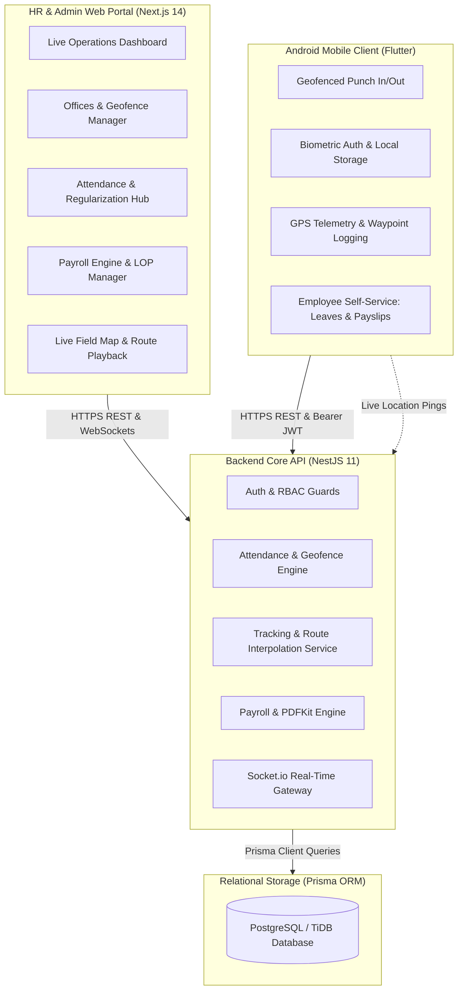
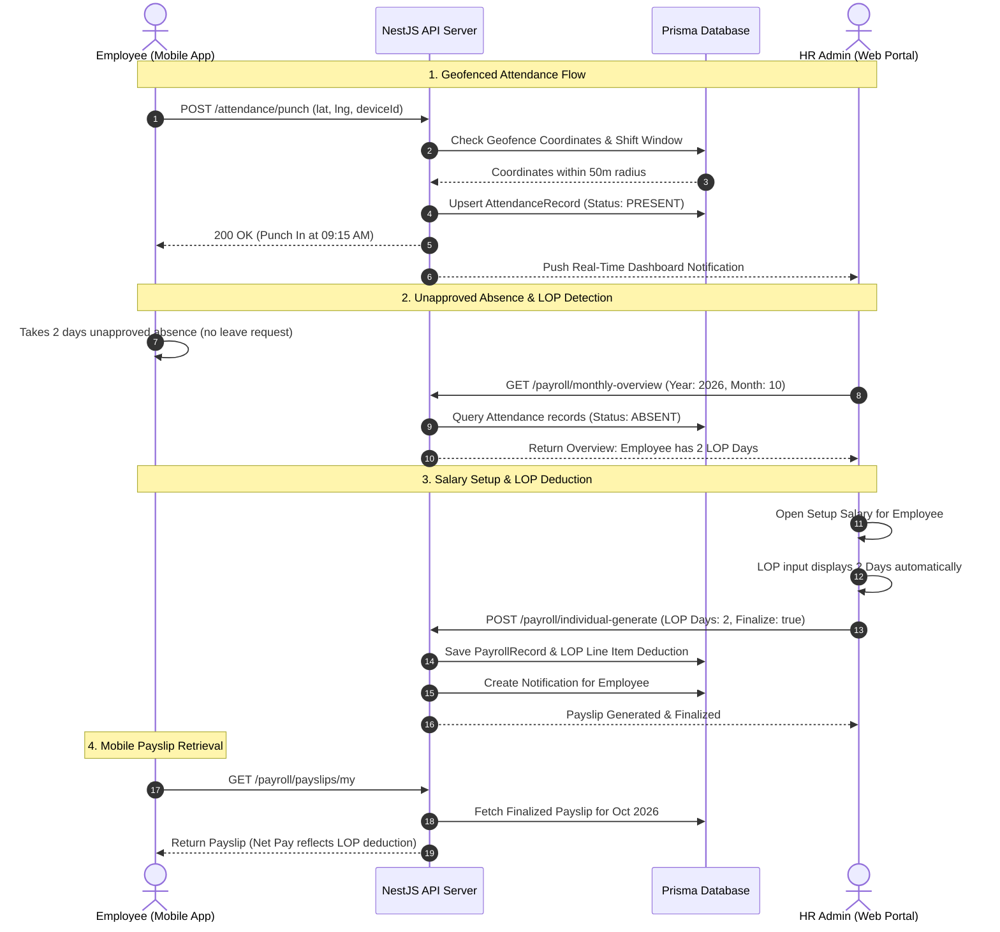
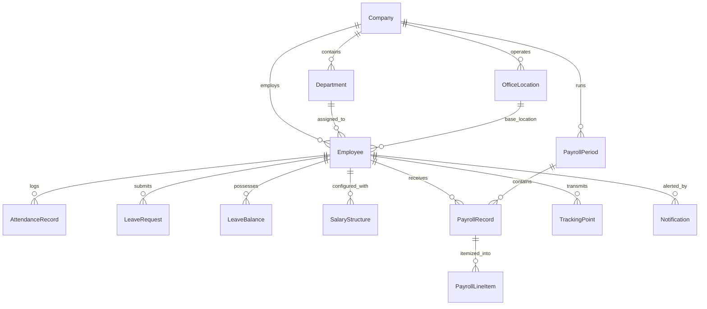

# Enterprise HRMS & Field Workforce Management System
## Complete Technical Architecture, Operational Workflows & Application Usage Guide

---

## 1. Executive Summary & Architectural Overview

The **Enterprise HRMS & Field Workforce Management System** is a full-stack, cloud-native Human Resource Management and Live Field Operations platform designed for modern enterprises managing both stationary office personnel and on-field operational workforces (e.g., aeronautical engineers, drone operators, and field survey teams).

The platform bridges real-time mobile telemetry with core HR administration:
- **Mobile First**: Geofenced attendance capture, biometric authentication, field route tracking, and instant mobile self-service (leaves, regularizations, payslips).
- **Administrative Precision**: Multi-tenant company hierarchy, automated attendance derivation, unapproved absence / Loss of Pay (LOP) salary deductions, automated payroll calculation, PDF generation, and real-time live map tracking.

---

## 2. Complete Technology Stack

### 2.1 Mobile Application (`Android_App`)
| Layer / Component | Technology / Library | Purpose & Implementation |
| :--- | :--- | :--- |
| **Framework** | Flutter 3.x / Dart (SDK `>=3.2.0 <4.0.0`) | Cross-platform native compilation with high-performance UI rendering |
| **Networking** | `dio: ^5.7.0` | HTTP client with global JWT request/response interceptors and timeouts |
| **Security & State** | `flutter_secure_storage: ^9.2.2` | Encrypted keystore storage for JWT tokens and sensitive employee credentials |
| **Biometrics** | `local_auth: ^2.3.0` | Hardware fingerprint and facial recognition authentication for rapid, secure login |
| **Geofencing & GPS** | `geolocator: ^13.0.2` | High-precision GPS coordinates acquisition for punch validation and field duty |
| **Maps & Rendering** | `google_maps_flutter: ^2.10.0` | Embedded Google Maps for geofence visual verification and route tracking |
| **Local Notifications** | `flutter_local_notifications: ^18.0.1` | Local alerts for punch reminders, leave updates, and payslip publications |
| **Device Hardware** | `battery_plus: ^6.2.1`, `permission_handler: ^11.3.1` | Battery state monitoring during background GPS tracking and runtime permission handling |

### 2.2 Web Administration Portal (`Web_App/apps/web`)
| Layer / Component | Technology / Library | Purpose & Implementation |
| :--- | :--- | :--- |
| **Framework** | Next.js 14.2.24 (App Router) | React Server Components, client state management, dynamic routing |
| **Language** | TypeScript 5.7 | Strict type safety across components, props, and API interfaces |
| **Styling & Design** | Tailwind CSS 3.4.17 | Utility-first responsive design matching enterprise SaaS UX standards |
| **Icons & UI Kit** | `lucide-react: ^0.475.0` | Vector icon suite for dashboards, action buttons, and status indicators |
| **Mapping Engine** | `leaflet: ^1.9.4`, `@googlemaps/js-api-loader: ^1.16.8` | Satellite imagery, geofence polygon rendering, and field trip route playback |
| **Spreadsheets** | `xlsx: ^0.18.5` | Dynamic client-side parsing and generation of payroll and attendance Excel templates |
| **Real-time Client** | `socket.io-client: ^4.8.1` | Low-latency bi-directional WebSocket connection for live field telemetry |

### 2.3 Backend API Server (`Web_App/apps/api`)
| Layer / Component | Technology / Library | Purpose & Implementation |
| :--- | :--- | :--- |
| **Runtime & Framework** | Node.js / NestJS 11.0.1 | Enterprise modular backend framework with dependency injection and decorators |
| **ORM & Data Layer** | Prisma ORM 6.4.1 | Schema migrations, type-safe database queries, and connection pooling |
| **Authentication** | `@nestjs/jwt`, `@nestjs/passport`, `passport-jwt: ^4.0.1` | Stateless JWT token issuance and role-based guards (`RolesGuard`) |
| **Password Hashing** | `bcrypt: ^5.1.1` | Salted hashing for user credentials |
| **Input Validation** | `class-validator: ^0.14.1`, `class-transformer: ^0.5.1` | Strict DTO validation and type coercion |
| **PDF Generation** | `pdfkit: ^0.16.0` | Dynamic programmatic generation of official payslip PDFs with custom formatting |
| **Real-Time Gateway** | `@nestjs/websockets`, `socket.io: ^4.8.1` | WebSocket server emitting live GPS telemetry to connected HR dashboards |
| **API Documentation** | `@nestjs/swagger: ^11.0.3`, `swagger-ui-express: ^5.0.1` | Auto-generated interactive Swagger OpenAPI specification |
| **Task Scheduling** | `@nestjs/schedule: ^5.0.1` | Automated cron jobs for daily attendance calculation, shift auto-close, and audits |

### 2.4 Database & Infrastructure
- **Database Engine**: PostgreSQL / TiDB (Relational SQL with full ACID compliance).
- **Timezone Standardization**: All backend database events are stored in UTC and converted dynamically to **Indian Standard Time (`Asia/Kolkata`, UTC+05:30)** for business reporting.
- **Web Server & Reverse Proxy**: Nginx 1.24+ terminating TLS and reverse proxying to Web (port 3000) and API (port 3001).

---

## 3. Detailed Operational Working Flows

### 3.1 Authentication & Role-Based Access Control (RBAC)
1. **User Identity Hierarchy**:
   - `SUPER_ADMIN`: Complete multi-tenant oversight across all registered enterprise companies.
   - `HR_ADMIN` / `HR_MANAGER`: Full management of employees, geofences, attendance policies, leave approvals, payroll runs, and circulars within their assigned company.
   - `EMPLOYEE`: Access restricted to self-service endpoints (own attendance history, leave applications, regularization requests, personal payslips, and notifications).
2. **Token Architecture**:
   - Access tokens are signed using HMAC SHA-256 containing `sub`, `email`, `roles`, `companyId`, and `employeeId`.
   - On the mobile client, tokens are saved to the encrypted hardware keystore (`flutter_secure_storage`).
   - If an employee profile lacks `employeeId` in older JWT sessions, the backend transparently resolves the record using `prisma.employee.findUnique({ where: { userId } })`.

### 3.2 Geofenced Attendance Lifecycle
1. **Office Geofence Setup**:
   - HR establishes one or more office locations via the Web Admin with a central GPS coordinate (latitude, longitude) and a defined geofence boundary (e.g., 50-meter radius).
2. **Punch-In Execution**:
   - The employee taps **Punch In** in the mobile app.
   - The device retrieves high-accuracy GPS coordinates via `geolocator`.
   - The API evaluates the coordinate against the office geofence using the **Haversine spherical distance formula**:
     $$d = 2r \arcsin\left(\sqrt{\sin^2\left(\frac{\Delta\phi}{2}\right) + \cos(\phi_1)\cos(\phi_2)\sin^2\left(\frac{\Delta\lambda}{2}\right)}\right)$$
   - If $d \le \text{radius}$, the punch is validated. If outside, the request is rejected with the exact distance variance.
3. **Status Derivation**:
   - Compared against the employee's assigned shift (`09:00 AM – 05:30 PM`):
     - Arrived before grace cutoff $\to$ `PRESENT`.
     - Arrived after grace cutoff $\to$ `LATE`.
     - Worked less than 4 hours $\to$ `HALF_DAY`.
     - No punch recorded $\to$ marked as `ABSENT`.

### 3.3 Live Field Telemetry & Route Playback
1. **Waypoint Logging**:
   - For employees on field assignments, the mobile client periodically transmits telemetry records containing `{ latitude, longitude, speed, battery, timestamp }`.
2. **WebSocket Real-Time Broadcast**:
   - The NestJS `TrackingGateway` broadcasts incoming coordinates to active HR browser sessions listening on the `field-tracking` channel.
3. **Route Reconstruction & Address Resolution**:
   - The tracking engine groups sequential points into daily field trips, calculates total distance traveled, duration, and stops.
   - Timestamps are formatted in local IST (`Asia/Kolkata`).
   - Reverse-geocoded waypoint addresses are presented alongside high-contrast timeline pins.

### 3.4 Leave Management & Sandwich Rule Policy
1. **Submission**:
   - Employees choose leave categories: Casual Leave (CL), Sick Leave (SL), Earned Leave (EL), or Unpaid Leave.
   - The system checks available balances stored in `LeaveBalance`.
2. **Sandwich Rule Enforcement**:
   - If an employee takes leave on Friday and Monday, the intermediate weekend days (Saturday & Sunday) are automatically included as consumed leave days based on company policy.
3. **Approval Lifecycle**:
   - Requests enter `PENDING` state and alert the designated manager and HR Admin.
   - Upon approval, the employee's attendance record for those dates is updated to `ON_LEAVE` (Paid), preserving salary entitlements.

### 3.5 Payroll Engine, LOP Deductions & Payslip Distribution
1. **Salary Structure Setup**:
   - Base components: Basic Salary, HRA (amount or % of Basic), DA (amount or % of Basic), TA/Conveyance, Special Allowance, Medical, and Other Allowances.
   - Statutory Deductions:
     - **EPF**: 12% of Basic (capped at ₹15,000 threshold or customized).
     - **ESI**: 0.75% employee / 3.25% employer for gross $\le$ ₹21,000.
     - **Professional Tax (PT)**: Regional slab deduction (standard ₹200/mo).
     - **TDS**: Monthly withholding based on tax declarations.
2. **Automated Loss of Pay (LOP) Deduction**:
   - If an employee is absent without an approved leave request, the attendance record marks them as `ABSENT`.
   - The payroll engine calculates the per-day salary rate:
     $$\text{Per Day Rate} = \frac{\text{Gross Monthly Salary}}{\text{Total Working Days (e.g. 26)}}$$
   - When HR opens **Setup Salary** or views the monthly payroll overview, the system auto-populates the employee's exact LOP days.
   - The LOP deduction is computed as:
     $$\text{LOP Deduction Amount} = \text{round}(\text{Per Day Rate} \times \text{LOP Days})$$
   - **Per-Employee Strict Isolation**: LOP is isolated by unique `employeeId` key in database records and frontend state, guaranteeing zero cross-employee contamination.
3. **Payslip Generation & Finalization**:
   - HR can run batch payroll across the entire company or generate individual payslips.
   - Finalization locks the record status (`FINALIZED`), creates distinct `PayrollLineItem` records (including `Loss of Pay (LOP) - X Day(s)`), generates the authenticated PDF buffer via `pdfkit`, and dispatches push notifications to the mobile app.
4. **Mobile Payslip Access**:
   - Mobile users open the **Payslips** screen, select the calendar year via a single-year dropdown (e.g., `2026`), and inspect detailed earnings, deductions, working days, and net take-home pay.

---

## 4. Complete Application Usage Guide

### 4.1 Guide for HR Admins & Super Admins (Web Portal)

#### A. Live Dashboard & Workforce Monitoring (`/dashboard`)
- **Key Metrics**: View total active headcount, today's presence percentage, late arrivals, employees on leave, and pending approval counts.
- **Quick Links**: Access daily attendance logs, pending regularization requests, and monthly payroll runs.

#### B. Managing Offices & Geofences (`/offices`)
1. Click **Offices & Geofences** from the left navigation bar.
2. Click **+ Add Office Location**.
3. Enter Office Name (e.g., `Superbee Aeronautics HQ`), physical address, and coordinates (Latitude & Longitude).
4. Define the Geofence Radius (default: `50` meters).
5. Click **Save Geofence**. Any mobile punch outside this circle will be rejected.

#### C. Employee Management & Onboarding (`/employees`)
1. **Add Single Employee**: Click **+ Add Employee**, enter personal details, email, contact number, joining date, department, designation, and reporting manager.
2. **Credentials**: The system automatically provisions a user account with standard employee role.
3. **Directory Search**: Search employees by name, employee code (e.g., `SB-004`), or department.

#### D. Attendance Reports & Regularization (`/attendance`, `/daily`, `/monthly`, `/inout-report`)
- **Daily Report**: View punch-in and punch-out timestamps, total hours worked, and geofence verification status for every employee.
- **Regularization Approvals**:
  1. Open **Attendance Regularization** queue.
  2. Review the employee's claimed punch time and reason (e.g., *Client onsite meeting*).
  3. Click **Approve** to update the punch time and convert an `ABSENT` status to `PRESENT`, or **Reject** with comments.

#### E. Payroll Management, LOP Deductions & Publishing (`/payroll`)
1. **Tab 1: Salary Setup**:
   - Search for any employee in the directory table.
   - Inspect the **LOP** column to see unapproved absence days auto-detected from attendance records.
   - Click **Edit / + Setup** to open the Salary Structure modal:
     - Enter Basic Salary, HRA, DA, and allowances.
     - Review Deductions: PF, ESI, Professional Tax, and TDS.
     - Verify the **Loss of Pay (LOP) Days** field. If the employee was absent for 2 days without approved leave, the modal shows `2 Days` and calculates the deduction amount.
     - Click **Save Salary Structure**.
2. **Tab 2: Payroll Runs**:
   - Click **Run Payroll** for the target month (e.g., `October 2026`).
   - Review total gross payout, statutory deductions, LOP deductions, and net payable amount.
   - Click **Publish Payslips** or **Finalize**: This invokes `/payroll/finalize-all`, committing finalized records and notifying employees.
3. **Tab 3: Individual Payslips**:
   - Select the employee and month from the dropdowns.
   - Verify the generated payslip preview (Working days, Present, Leave, LOP Days, and Net Take-Home Pay).
   - Click **Publish to Mobile** to push the payslip directly to the employee's mobile device, or click **Print** to export a hard copy.

#### F. Live Field Tracking (`/tracking`)
1. Click **Live Field Tracking** in the sidebar.
2. Select the field employee and mission date.
3. View the full geographic route on the satellite map with sequenced waypoint markers.
4. Use the playback controls (**Play**, **1x**, **2x**, **5x**) to simulate field movement.
5. Review the sidebar trip summary: total distance in km, active duration, origin departure time, and latest waypoint address in IST.

---

### 4.2 Guide for Employees (Android Mobile App)

#### A. Login & Biometric Setup
1. Launch the mobile app on Android.
2. Enter your corporate email and password, then tap **Sign In**.
3. On prompt, enable **Biometric Authentication** (Fingerprint or Face Unlock) for one-touch login on future sessions.

#### B. Daily Punch-In & Punch-Out (`Home Tab`)
1. Ensure your device GPS / Location is toggled **ON**.
2. When within 50 meters of your assigned office, open the app.
3. Tap the **Punch In** button on the home dashboard.
4. The system validates your geofence and marks you `Present` with the current time.
5. At the end of your shift, tap **Punch Out** to record your shift completion.

#### C. Leave Applications & Balance (`Action Tab` $\to$ `Apply for Leave`)
1. Tap the **Action** tab in the bottom navigation bar.
2. Select **Apply for Leave**.
3. Choose Leave Type: Casual Leave (CL), Sick Leave (SL), or Earned Leave (EL).
4. Select the Start Date and End Date.
5. Enter a brief reason and tap **Submit Application**.
6. Monitor the status under **My Requests & Approvals**. Once approved by HR, your calendar automatically updates.

#### D. Attendance Regularization (`Action Tab` $\to$ `Attendance Regularization`)
1. If you forgot to punch in or were traveling on official business, tap **Attendance Regularization**.
2. Select the affected date and the actual punch-in/out times.
3. Enter the official explanation and tap **Request Regularization**.
4. HR will review and approve your request.

#### E. Accessing & Downloading Monthly Payslips (`Explore Tab` $\to$ `Payslips` / Profile Tile)
1. Tap **My Profile** or open **Payslips** from the Explore menu.
2. At the top-left dropdown, select the annual year (e.g., `2026`).
3. Tap on the month strip (e.g., `Oct`).
4. View your full payslip breakdown:
   - **Summary Strip**: Total Working Days, Days Present, Paid Leaves, and LOP Days.
   - **Earnings**: Basic Salary, HRA, DA, Allowances, Gross Earnings.
   - **Deductions**: PF (Employee 12%), Professional Tax, TDS, and Loss of Pay (LOP) if applicable.
   - **Net Take-Home Pay**: Total net salary deposited to your bank account.

---

## 5. REST API Endpoint Directory

### Authentication & Profiles
| Method | Endpoint | Access Roles | Description |
| :--- | :--- | :--- | :--- |
| `POST` | `/auth/login` | Public | Authenticates credentials and returns JWT access token |
| `POST` | `/auth/google` | Public | Google OAuth2 single sign-on token validation |
| `GET` | `/auth/me` | All Authenticated | Returns currently authenticated user and employee profile |

### Attendance & Geofencing
| Method | Endpoint | Access Roles | Description |
| :--- | :--- | :--- | :--- |
| `POST` | `/attendance/punch` | All Authenticated | Records employee punch-in or punch-out with GPS coordinates |
| `GET` | `/attendance/today` | All Authenticated | Returns current day punch status and total hours |
| `GET` | `/attendance/my` | All Authenticated | Retrieves personal historical attendance logs |
| `GET` | `/attendance/daily` | HR / Admin | Aggregates daily attendance for all company employees |
| `POST` | `/attendance/regularize` | All Authenticated | Submits attendance regularization request |
| `PUT` | `/attendance/regularize/:id` | HR / Admin | Approves or rejects regularization request |

### Offices & Locations
| Method | Endpoint | Access Roles | Description |
| :--- | :--- | :--- | :--- |
| `GET` | `/offices` | All Authenticated | Lists all company office locations and geofence coordinates |
| `POST` | `/offices` | HR / Admin | Creates a new office location with radius geofence |
| `PUT` | `/offices/:id` | HR / Admin | Modifies existing geofence parameters or status |

### Field Tracking & Telemetry
| Method | Endpoint | Access Roles | Description |
| :--- | :--- | :--- | :--- |
| `POST` | `/tracking/ping` | All Authenticated | Submits high-precision GPS waypoint from mobile device |
| `GET` | `/tracking/timeline` | HR / Admin | Retrieves reconstructed daily route waypoints with IST timestamps |
| `GET` | `/tracking/live` | HR / Admin | Retrieves current active locations of all field personnel |

### Leave Management
| Method | Endpoint | Access Roles | Description |
| :--- | :--- | :--- | :--- |
| `GET` | `/leaves/my-balances` | All Authenticated | Retrieves remaining leave balances (CL, SL, EL) |
| `POST` | `/leaves/apply` | All Authenticated | Submits new leave application |
| `GET` | `/leaves/pending` | HR / Admin | Lists pending leave requests requiring review |
| `PUT` | `/leaves/:id/status` | HR / Admin | Approves or rejects leave application |

### Payroll & Payslips
| Method | Endpoint | Access Roles | Description |
| :--- | :--- | :--- | :--- |
| `GET` | `/payroll/monthly-overview` | HR / Admin | Monthly salary overview with auto-calculated LOP days per employee |
| `POST` | `/payroll/bulk-upload` | HR / Admin | Imports multi-employee salary structures via Excel/CSV |
| `POST` | `/payroll/individual-generate`| HR / Admin | Generates or finalizes individual payslip with LOP and allowances |
| `PUT` | `/payroll/finalize-all` | HR / Admin | Finalizes all employee payslips for the month and notifies mobile apps |
| `GET` | `/payroll/payslips/my` | All Authenticated | Retrieves employee's published and finalized payslips |
| `GET` | `/payroll/payslips/:id/pdf` | Employee / HR | Streams dynamically generated official PDF payslip |

---

## 6. Database Entity-Relationship Reference

### Key Data Models
1. **`Employee`**: Master record containing personal identity, employee code (`employeeCode`), joining date, bank details (`bankName`, `bankAccountNumber`), tax identifiers (`panNumber`, `uanNumber`), department, designation, and company reference.
2. **`AttendanceRecord`**: Daily attendance snapshot capturing `date`, `punchIn`, `punchOut`, total `hoursWorked`, `status` (`PRESENT`, `ABSENT`, `HALF_DAY`, `LATE`, `ON_LEAVE`), and geofence verification metadata.
3. **`PayrollRecord`**: Finalized monthly payroll record for an employee under a `PayrollPeriod`, capturing `basicEarnings`, `allowancesEarnings`, `grossEarnings`, `statutoryDeductions`, `otherDeductions`, `lopDays`, `totalDeductions`, `netSalary`, and `status` (`FINALIZED`).
4. **`PayrollLineItem`**: Granular earning or deduction item attached to a `PayrollRecord` (e.g., `Basic Salary`, `HRA`, `PF`, `Loss of Pay (LOP) - 2 Day(s)`).
5. **`TrackingPoint`**: High-frequency GPS waypoint storing latitude, longitude, accuracy, speed, battery level, and recorded timestamp.

---

## 7. Troubleshooting & Operational FAQs

### Q1: Why did the mobile app display "Outside Geofence" during punch-in?
- **Root Cause**: The device's GPS accuracy was low, or the employee was physically outside the configured radius (e.g. 50 meters) of the assigned office.
- **Resolution**:
  1. Ensure device location is set to **High Accuracy**.
  2. HR can inspect the punch coordinates in the Daily Attendance log and adjust the office radius in `/offices` if the building perimeter exceeds 50 meters.

### Q2: Why did an employee have an LOP deduction on their payslip?
- **Root Cause**: The employee was marked `ABSENT` on one or more working days without a corresponding approved leave request.
- **Resolution**:
  1. If the absence was legitimate (e.g. approved offline or client work), the employee can submit an **Attendance Regularization** request.
  2. Once HR approves the regularization, the status updates to `PRESENT`, and HR can re-save or re-generate the salary structure without LOP days.

### Q3: Why wasn't a published payslip visible on the mobile device?
- **Root Cause**: In earlier builds, the web publish button did not commit finalized records to the database, or the user's JWT token lacked a direct `employeeId` claim.
- **Resolution**:
  - The latest update automatically resolves employee profiles by user ID, checks for `{ status: FINALIZED }` records, and raises the mobile request timeout to 15 seconds. Ensure HR clicks **Publish Payslips** or **Publish to Mobile** in the Web Portal to push the record live.

---
*Documentation Version: 2.4.0 — Maintained by Enterprise HRMS Engineering Team.*
