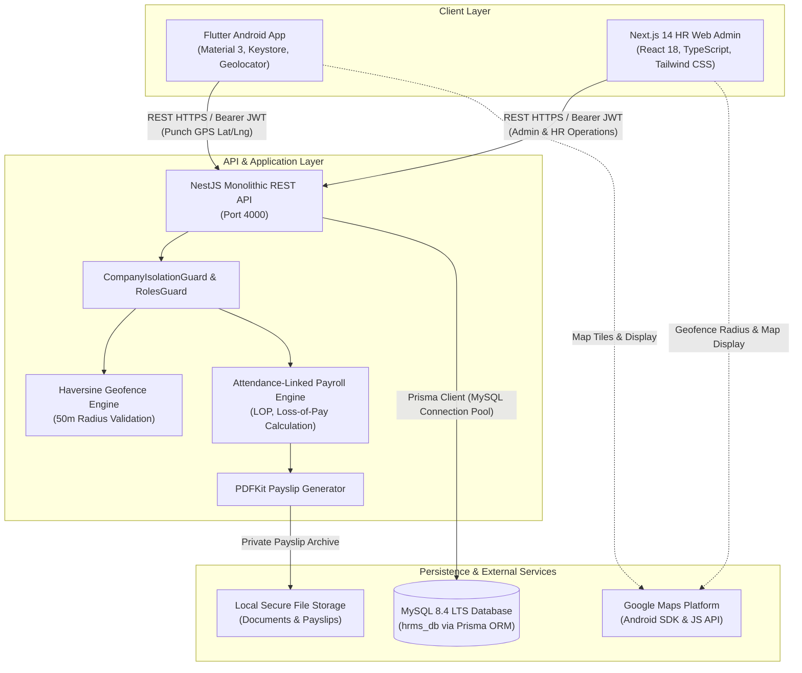
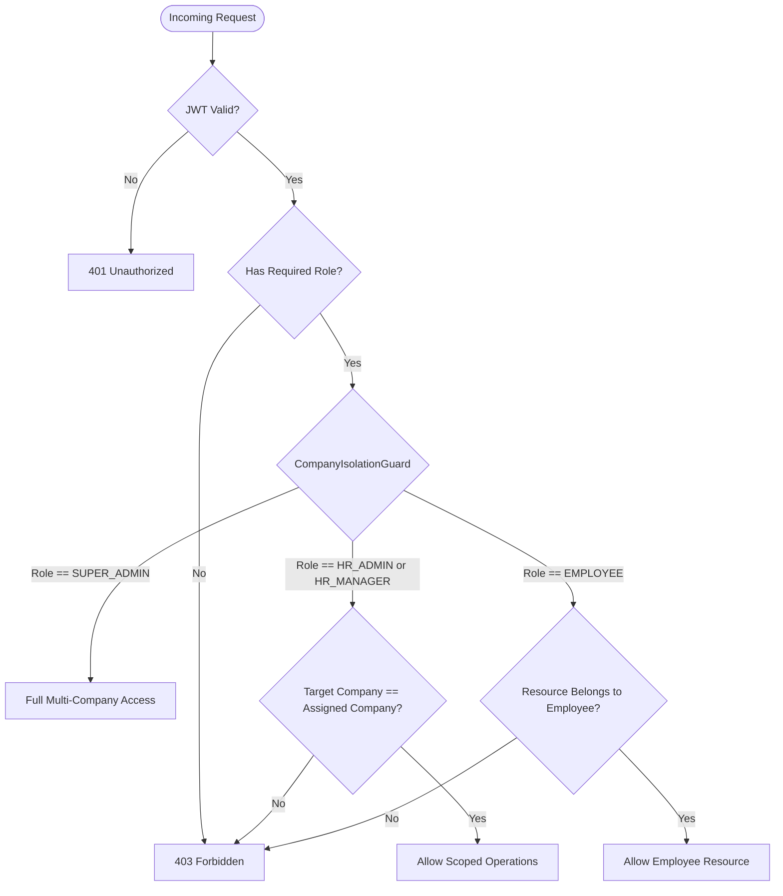
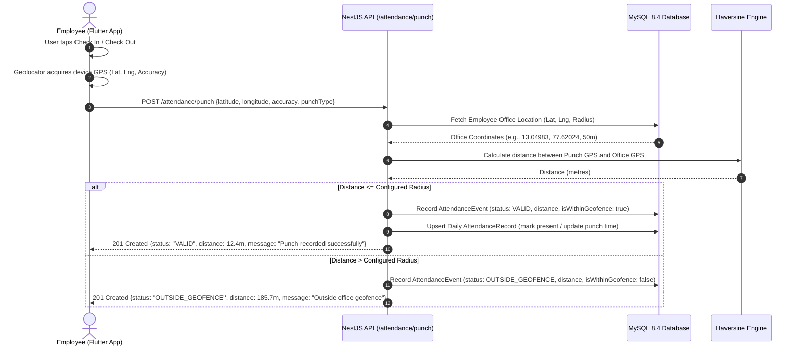

# System Architecture Specification

## 1. Overview & High-Level Architecture

The Human Resource Management System (HRMS) is designed as a secure, production-grade, multi-company platform engineered to deliver greytHR-level capabilities without external Firebase dependencies. The platform comprises three primary sub-systems and a unified persistence layer:

---

## 2. Core Design Principles

1. **Zero Firebase Architecture**:
   - Authentication, session revocation, database queries, in-app notifications, and push-polling mechanisms are 100% self-hosted on NestJS and MySQL 8.4.
   - No Firebase Auth, Firestore, FCM, Firebase Storage, or Firebase Analytics.
2. **Authoritative Backend Validation**:
   - While the mobile app and web dashboard render interactive maps with Google Maps, all geofencing calculations (using the Haversine distance algorithm) and office boundary verifications are strictly computed and enforced on the NestJS backend.
3. **Multi-Company Data Isolation**:
   - The platform serves three distinct corporate entities: `SUPERBEE`, `GTIDS`, and `GTIB`.
   - Data separation is enforced at the controller and query levels using `CompanyIsolationGuard`, preventing unauthorized cross-company data access.
4. **Event-Based Location Privacy**:
   - Geolocation coordinates are captured **only** at the explicit moment of an attendance punch or exception request. Continuous background location tracking is strictly forbidden and structurally omitted.
5. **Asia/Kolkata Standard Timezone**:
   - All shifts (09:00–17:30 IST), late arrivals (after 09:30 IST), half-day calculations, and payslip generation follow the standard Indian Standard Timezone (Asia/Kolkata, UTC+05:30).

---

## 3. Sub-System Details

### 3.1 Android Employee Application (`apps/mobile`)
- **Framework**: Flutter 3.x & Dart.
- **UI Guidelines**: Material 3 Design System with high-contrast emerald and slate palette.
- **Networking**: `dio` client configured with interceptors for token auto-injection and 401 handling.
- **Secure Storage**: `flutter_secure_storage` backed by Android Keystore (AES encryption) for access and refresh tokens.
- **Location & Mapping**: `geolocator` for fine-grained GPS coordinate acquisition; `google_maps_flutter` for geofence circle preview and check-in confirmation.
- **Navigation**: 5-tab Material 3 bottom navigation:
  1. **Home**: GreytHR-style quick punch card, live greeting, active circulars carousel, quick actions.
  2. **Attendance**: Detailed punch card, monthly statistics, punch history with validation badges, attendance correction request modal.
  3. **Leave Desk**: Balances overview (CL, SL, EL), interactive leave application form, status badges.
  4. **Calendar**: 4-mode dropdown (`Holidays`, `Payslips`, `Attendance`, `Office Timing`), monthly calendar picker.
  5. **More**: In-app notifications feed, circulars with acknowledgment buttons, helpdesk ticket tracker, profile, and secure logout.

### 3.2 HR Administration Web Dashboard (`apps/web`)
- **Framework**: Next.js 14 App Router, React 18, TypeScript, Tailwind CSS.
- **Modules**:
  - `/login`: Clean authentication screen with quick-fill demo chips for Super Admin, HR Admins, and Employees.
  - `/dashboard`: 8 operational metric cards, active office locations with geofence radiuses, recent company attendance table.
  - `/offices`: Interactive Google Maps geofence configurator with 50m radius slider, coordinate picker, interactive test coordinate distance validator, and audit history.
  - `/attendance`: Live real-time attendance monitor, geofence validation outcome badges, GPS punch map modal, manual override modal with audit reasons, and correction request review modal.
  - `/employees`: Employee directory, multi-company filtering, employee creation with geofenced office assignment.
  - `/leave`: Entitlements overview, pending leave applications with approve/reject remarks.
  - `/calendar`: greytHR 4-option calendar viewer (`Holidays`, `Payslips`, `Attendance`, `Office Timing`).
  - `/payroll`: Attendance-linked payroll computation engine with Loss of Pay (LOP) calculations, review, salary override modal, finalization lock, and inline PDF payslip download.
  - `/circulars`: Circular creation modal with multi-company target checkboxes (`SUPERBEE`, `GTIDS`, `GTIB`), acknowledgement logs.
  - `/helpdesk`: Employee ticket management and response thread composer.
  - `/reports`: Headcount analytics, geofence validation distribution, CSV export.
  - `/audit`: Searchable audit log of all sensitive HR actions and configuration changes.

### 3.3 Backend REST API (`apps/api`)
- **Framework**: NestJS 10, TypeScript.
- **Persistence**: Prisma ORM 5 connecting to MySQL 8.4 LTS via connection pooling.
- **Authentication**: Passport JWT strategy, bcrypt password hashing (10 salt rounds), secure refresh token rotation stored in database.
- **Security**: Helmet headers, CORS policies, rate-limiting throttle guard, parameterized SQL via Prisma.
- **PDF Generation**: `pdfkit` for generating professional A4 company-branded payslips with earnings, deductions, and net pay breakdown.
- **Documentation**: Swagger OpenAPI documentation available at `/api/docs`.

---

## 4. Multi-Tenant Authorization Model

- **SUPER_ADMIN**: Global access across all companies (`SUPERBEE`, `GTIDS`, `GTIB`). Can create offices, assign HR admins, modify company configurations, and audit all logs.
- **HR_ADMIN**: Scoped strictly to assigned company. Manages employees, shifts, leave policies, office geofences, attendance corrections, and payroll finalization.
- **HR_MANAGER**: Scoped to assigned company. Reviews attendance, approves leave applications, and views operational reports.
- **EMPLOYEE**: Scoped strictly to their own employee ID and company. Punches attendance, submits leave, acknowledges circulars, raises tickets, and views personal payslips.

---

## 5. Geofence & Attendance Verification Flow

The server calculates distance using the Haversine formula:
$$d = 2r \arcsin\left(\sqrt{\sin^2\left(\frac{\Delta \phi}{2}\right) + \cos(\phi_1)\cos(\phi_2)\sin^2\left(\frac{\Delta \lambda}{2}\right)}\right)$$
where $r = 6371000\text{ m}$.
